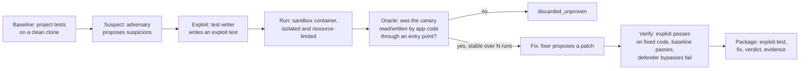

# Exhibit A

```text
+----------------------------------------------------------+
|                        EXHIBIT A                         |
|                 proof before accusation                  |
+----------------------------------------------------------+
  EXHIBIT A - proof before accusation
```

**Proof before accusation: Exhibit A only reports vulnerabilities it can prove.**

[Video demo](VIDEO_URL_PLACEHOLDER)

Exhibit A is a Python security-verification engine for pull requests. It turns a
suspicion into a finding only when an exploit test fails for the intended
oracle-observed reason in an **isolated and resource-limited** sandbox, then
passes after a fix while the baseline and bypass checks remain valid. Nothing
merges itself.

## How it works



The CLI scans the repository, builds an AST-only static slice, runs the
verification loop, and packages the ledger and evidence. The GitHub Action
uses the same engine on a pull-request diff. A green result means
**nothing could be proven**, never safe.

## Install in 3 steps

1. Install Exhibit A in the repository environment:

   ```bash
   python -m pip install -e .
   ```

2. Generate the GitHub workflow:

   ```bash
   exhibit-a init
   ```

3. In repository settings, create the protected `exhibit-a` environment with
   the `EXHIBIT_A_API_KEY` secret, set the `EXHIBIT_A_ENABLED=true` repository
   variable, and require these checks on the default branch:
   `exhibit-a / verify` and `exhibit-a / fork-guard`.

   Merges are blocked only when branch protection or rulesets require those
   checks. A repository administrator can bypass that protection.

The generated workflow runs compact, sliced PR verification, posts a comment,
and suggests verified fixes. Fork pull requests receive no model-key run and
must be reviewed by a maintainer.

The workflow also has a deliberately small, rule-based risk gate. It classifies
changed paths as low, medium, or high risk: documentation and tests can skip
the exploit loop, while application, dependency, container, CI, and sensitive
directory changes run it. The gate does not inspect file contents, call a
model, or prove a vulnerability; the verification loop does that.

## A real PR result

On the private testbed, a path-traversal PR produced this comment:

> 🔴 1 proven finding
>
> Status: `completed`
>
> The oracle observed a `canary_read` through
> `App.handle_request -> read_text -> builtins.open` at `memos.py:22`.
> The exploit failed on the vulnerable tree, the fix was verified, and the
> evidence was uploaded in the `exhibit-a-ledger` artifact.

The same run posted a verified review suggestion for `memos.py`. The suggested
fix confined the requested path to the permitted directory; the report records
the change as `memos.py` `+5/-1`, with the exploit passing after the fix.
See the complete run table and links in
[docs/ci/chain-validation.md](docs/ci/chain-validation.md).

## The dashboard

Run the local, read-only dashboard from any repository:

```bash
exhibit-a dashboard
```

It binds to `127.0.0.1`, prints a one-time local link, and shows data for the
current repository. It has no Exhibit A account. By default it reads local
`runs/` data when present, or detects the GitHub remote and reads the
repository's Action artifacts through your authenticated `gh` CLI. You can
choose explicitly:

```bash
exhibit-a dashboard --source local:runs
exhibit-a dashboard --source github:OWNER/REPOSITORY
```

## Results

The benchmark figures below are copied from
[bench/results/2026-11-01.json](bench/results/2026-11-01.json). They are
measured corpus results, not a claim about general-world recall.

| System | Reported | True positives | False positives | False accusations | Precision | Recall | Model cost |
|---|---:|---:|---:|---:|---:|---:|---:|
| Exhibit A, compact profile | 29 | 25 | 4 | 0 | 0.8621 | 0.6774 | US$2.272676 |
| Exhibit A, standard profile | 0 | 0 | 0 | 0 | n/a | 0.0000 | US$4.782448 |
| Naive LLM | 3 | 2 | 1 | 1 | 0.6667 | 1.0000 | US$0.070828 |

The live GitHub chain validation is recorded separately in
[docs/ci/chain-validation.md](docs/ci/chain-validation.md): 14 PRs, 1 proven
finding, 4 vulnerable misses, 0 control accusations, 0 adversarial false
`proven` results, 13 comments, 1 suggested fix, and US$0.0685 API cost.

## What it does NOT do

- A green result does **not** mean safe; it means nothing could be proven.
- It only proves the supported vulnerability classes and observable effects
  implemented by the current oracle.
- `SCAN` is rule-based. It proposes repository facts and reach paths; it is
  not a general vulnerability detector.
- Slicing is static and AST-based. A path outside the supported graph or
  effect can be missed.
- Coverage is limited to the benchmark cases and the declared residual limits.
- It does not audit an entire dependency repository, guarantee security, or
  merge changes automatically.

## Threat model

PR diffs, repository files, model output, and exploit tests are untrusted.
PR files are parsed on the host but are not executed there; model output is
schema-validated and test or fix code runs only in the sandbox. The sandbox
has no network or secrets, drops capabilities, uses a read-only filesystem
with bounded writable areas, and enforces CPU, memory, process, and wall-clock
limits. The dashboard is local-only and uses a one-time link.

The model API runs outside the sandbox. Fork PRs do not receive the protected
model key. Known oracle residuals and host-side limitations are documented in
[docs/security/THREAT_MODEL.md](docs/security/THREAT_MODEL.md) and
[docs/oracle/oracle-provenance.md](docs/oracle/oracle-provenance.md).

## Run the tests

Python 3.11+ and Docker or Colima are required for sandbox tests:

```bash
~/Desktop/Proyects/Exhibit-A/.venv/bin/python -m pytest
```

The full suite is the owner's checkpoint command. For a local install, the
same runner is available as `python -m pytest`; do not treat Docker-marked
tests as passing when Docker is unavailable.

## Built during the Meta Global AI Developer Hackathon

Exhibit A was built during the Meta Global AI Developer Hackathon. The build
history, design decisions, and implementation timeline are documented in
[docs/how-this-was-built.md](docs/how-this-was-built.md).

## More documentation

- [SPEC.md](SPEC.md): scope, proof standard, contracts, and non-goals.
- [docs/README.md](docs/README.md): documentation index.
- [docs/reference/cli.md](docs/reference/cli.md): CLI reference.
- [docs/ci/github-action.md](docs/ci/github-action.md): Action inputs and outputs.
- [SECURITY.md](SECURITY.md): reporting and security boundaries.
- [CONTRIBUTING.md](CONTRIBUTING.md): contribution workflow.
