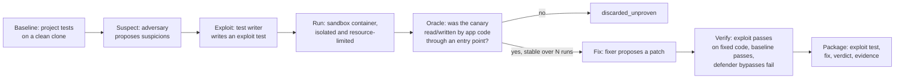

# Exhibit A — proof before accusation

Exhibit A is a Python security-verification engine that reports only vulnerabilities it can prove: a suspicion becomes a finding only when an exploit test fails on the vulnerable code for the oracle-observed reason, then passes after a fix.

## How a proof works



The oracle observes the intended effect (a canary file outside the allowed directory is read or written) and checks provenance: the effect must come from application code reached through a real entry point, not from the test calling the sink directly. Both the exploit run and the fixed-code re-run happen in an ephemeral sandbox container (unprivileged, no network, no secrets, read-only tree, CPU/memory/time limits). See [SPEC](SPEC.md) and [docs/design/architecture.md](docs/design/architecture.md).

## What `proven` means, and what green means

A finding is `proven` only if all five hold ([SPEC section 4](SPEC.md)):

1. Baseline tests pass on a clean clone.
2. The exploit test fails on the vulnerable code **and** the oracle saw the intended effect.
3. Provenance: the effect came from application code through a real entry point.
4. The result is stable across N repeated runs (default 3).
5. After the fix, the exploit passes and the baseline still passes; defender bypass variants fail, or the surviving one is reported with `fix_incomplete`.

Other verdicts: `discarded_unproven`, `invalid_test`, `flaky`, `env_failure`. A green result means **"nothing could be proven", never "safe"**. The sandbox is **isolated and resource-limited**, never "100% safe".

Declared residual limits of the oracle (each pinned by a strict xfail in `tests/test_oracle_residual.py`):

- R1: in-process introspection of the plugin (FALSE_PROVEN)
- R2: `sitecustomize` in the app tree (FALSE_PROVEN, host path)
- R3: subprocess reads (recall)
- R4: ctypes / native reads (recall)
- R5: dependency monkeypatching by computed names (FALSE_PROVEN)
- R6: obfuscated test-chosen app root (FALSE_PROVEN)

Details: [docs/oracle/oracle-provenance.md](docs/oracle/oracle-provenance.md) section 7. Only Python is analysed today, and only two effect classes are provable: path traversal on read (Starlette case) and archive-extraction write (zip-slip case); command injection, code injection, deserialization and SSRF have catalogued sinks but no oracle effect yet ([docs/design/code-graph.md](docs/design/code-graph.md)).

## Quickstart

Requirements: Python 3.11+ and Docker (or Colima) running — sandbox tests and the demo need it.

```bash
python -m pip install -e '.[dev]'
python -m exhibit_a.cli run --case bench/corpus/starlette-cve-2023-29159 --replay
```

`--replay` replays recorded model answers offline (no key, no network) but still executes every baseline and exploit test in the sandbox. Without `--replay` the roles call the provider chosen with `--provider`/`--model` (default a local Ollama model; pass `--provider meta --model muse-wonder-1.0` with `META_API_KEY` for Meta). A pull request is verified with `python -m exhibit_a.cli run --repo <dir> --pr-diff BASE..HEAD`. Exit codes ([docs/reference/cli-exit-codes.md](docs/reference/cli-exit-codes.md)): 0 nothing proven, 10 a finding proven, 20 run incomplete, 2 usage or input error. Full CLI reference: [docs/reference/cli.md](docs/reference/cli.md).

Demo (2-3 minute red-to-green story, [docs/reference/demo.md](docs/reference/demo.md)):

```bash
scripts/demo.sh --offline   # replay the committed Meta recordings; Docker must be running
scripts/demo.sh --live      # same story, answered live by Muse Wonder (needs META_API_KEY)
```

The offline path is covered by `test_offline_demo_ends_with_a_proven_finding_and_a_verified_fix` (docker-marked, runs in the CI `sandbox` job).

## GitHub Action usage

```yaml
- uses: ./  # or the pinned Exhibit A action SHA
  with:
    provider: meta
    model: muse-wonder-1.0
    api-key: ${{ secrets.EXHIBIT_A_API_KEY }}
```

The check runs `exhibit-a run --pr-diff BASE..HEAD` in a timeout, posts one marker PR comment, uploads the ledger artifact, and turns red only on a proven finding; green means nothing could be proven. Fork PRs get no run (fork guard), and the key is materialised in one step only. Details: [action.yml](action.yml), [docs/ci/github-action.md](docs/ci/github-action.md), [docs/ci/github-action-security.md](docs/ci/github-action-security.md).

## Results

Naive LLM versus the proof loop on the same corpus, same model (`muse-wonder-1.0`), from [docs/bench/bench.md](docs/bench/bench.md):

| system | reported | TP | FP | false accusations | precision | recall | cost (US$) |
|---|---|---|---|---|---|---|---|
| Naive LLM (reports everything) | 3 | 2 | 1 | 1 | 0.67 | 1.00 | 0.0708 |
| Exhibit A, compact profile | 2 | 2 | 0 | 0 | 1.00 | 1.00 | 0.3061 |
| Exhibit A, standard profile (nothing proven live) | 0 | 0 | 0 | 0 | n/a | 0.00 | 4.7824 |

Exhibit A's two reports each ship an exploit that fails on the vulnerable code plus a verified fix; the naive report is a list. Exhibit A cost about 4x the naive reporter here. Limits, stated in full in [docs/bench/bench.md](docs/bench/bench.md): 3 targets, one model sample each, the model is not deterministic, Exhibit A was tuned on these same cases with no held-out case, so recall 1.00 and zero false accusations are an illustration, not a rate.

## Meta models used

All model results come from Muse Wonder (`muse-wonder-1.0`), recorded unedited with costs and replayed offline ([docs/bench/meta-run.md](docs/bench/meta-run.md), [tests/test_meta_replay.py](tests/test_meta_replay.py)):

- **Standard profile, first live run (US$4.78, 20 calls): proved nothing**, including on both vulnerable cases — the test-writer prompt named the allowed directory but never said where the canary file is, so exploits wrote to invented filenames the oracle correctly ignored.
- **Compact profile (`--profile compact`, US$0.17 total): proved both vulnerable cases** — Starlette CVE-2023-29159 (US$0.11) and the archive zip-slip (US$0.06). Each ended `S1 proven` with a verified fix (the model replaced `os.path.commonprefix` with `os.path.commonpath`; the archive fix confines the member path) and 3 defender bypass variants tried, 0 succeeded. See [docs/bench/cost-controls.md](docs/bench/cost-controls.md) for what the profile bounds.

Negative control, reported honestly: the first live compact run on **fixed** Starlette ended with a FALSE proof — the test raced a thread swapping a served file for a symlink to the canary, and the oracle's check raced it in turn. The oracle now flags any link to the canary created during the run at creation time ([docs/oracle/oracle-provenance.md](docs/oracle/oracle-provenance.md) section 3.8); the recording is kept unedited as documentation, and replaying it against today's oracle proves nothing (`test_replaying_the_negative_control_proves_nothing`). A live run of the fixed tree after the fix proved nothing (0 `proven`, US$0.13), and live re-runs proved both vulnerable cases again ([docs/bench/meta-run.md](docs/bench/meta-run.md), "Live confirmation runs"; not recorded).

## SCAN / SLICE code graph

`exhibit-a scan --graph` builds an AST-only call graph of a Python tree (parsed, never imported) and maps a diff to entry-point → changed-function → sink paths; `exhibit-a run --slice` (opt-in, off by default) gives the adversary only that slice and, crucially, the oracle judges against the graph's entry point — the model's text can never widen what the oracle accepts. No path means no model call and exit 0. Both corpus paths and entry points are found automatically. Not yet measured: live-model cost/recall with `--slice`. Details: [docs/design/code-graph.md](docs/design/code-graph.md).

## Security summary

Exhibit A runs untrusted code (PR diffs, model-written exploits) on purpose. Trust boundaries: PR files are parsed, never executed on the host; model output is schema-validated JSON and only ever runs in the sandbox; the HMAC key travels on stdin and never enters the container image; the dashboard binds 127.0.0.1 with a one-time token. Known holes are declared, not hidden: host-path baseline, fork-PR limits, R1-R6 oracle limits. Full model: [docs/security/THREAT_MODEL.md](docs/security/THREAT_MODEL.md); integration audit: [docs/security/audit-integration.md](docs/security/audit-integration.md).

## Built during the Meta Global AI Developer Hackathon

The repository history backs this (`git log --reverse --format='%ad %h %s' --date=short`): the repository was created on 2026-10-26 with a two-line README (title and description, no code), and every line of code, test and documentation was written from 2026-10-27 onward, inside the build period (Oct 27 - Nov 4, [SPEC section 15](SPEC.md)). What was built there: the verification loop with the full proof standard (baseline → suspect → exploit → run → verdict → fix → verify → package), the sandbox runner, the oracle with signed events and authenticated provenance, the SCAN/SLICE code graph, the GitHub Action with risk gate, the naive-vs-loop benchmark, the real Meta-model recordings (standard and compact), the offline demo kit, the local dashboard, and the docs in this repository. Third-party corpus content (e.g. the Starlette case) stays under its original licenses (Starlette: BSD-3).

## Docs

Index: [docs/README.md](docs/README.md). Start with [SPEC](SPEC.md) for the authoritative scope, proof standard and contracts, then the per-area docs above. Research spikes (observer prototypes, red-team PoCs) are documented in [spikes/README.md](spikes/README.md) and are not product code.
