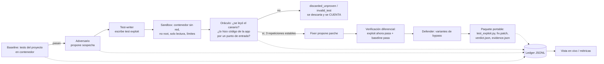

# Guía de Exhibit A (para presentar el proyecto)

Estado verificado el 2026-10-28 sobre `main` @ `89c74b7`. Todos los comandos de esta guía fueron ejecutados por mí y su salida confirmada; lo que no pude correr está marcado **NO VERIFICADO**. Los comandos usan `PY=~/Desktop/Proyects/Exhibit-A/.venv/bin/python` y se ejecutan desde la raíz del repo. Donde pongo `$OUT`, yo usé un directorio temporal equivalente (`--out` acepta cualquier ruta).

## 1. Qué es Exhibit A

Las herramientas de seguridad te entregan cientos de "sospechas" que nadie tiene tiempo de revisar, y un "todo verde" que no significa nada. Exhibit A hace lo contrario: **solo reporta lo que puede demostrar**. Una sospecha se convierte en hallazgo únicamente si un test de explotación **falla** en el código vulnerable *por la razón correcta* (por ejemplo, un archivo "canario" fuera del directorio permitido fue leído por el código de la aplicación), dentro de un contenedor aislado y con límites de recursos; luego el mismo test **pasa** tras un arreglo, las pruebas existentes siguen pasando y los intentos de rodear el arreglo fallan. Un resultado "verde" significa "no se pudo demostrar nada", **nunca** "es seguro".

## 2. Flujo completo



Veredictos posibles: `proven`, `discarded_unproven`, `invalid_test`, `flaky`, `env_failure`. Un `env_failure` no prueba nada.

## 3. Cada pieza y cómo verla

Primero la corrida de referencia que alimenta varias secciones:

```bash
PY=~/Desktop/Proyects/Exhibit-A/.venv/bin/python
$PY -m exhibit_a.cli run --case bench/corpus/starlette-cve-2023-29159 --replay --out $OUT
```
Salida real (4.6 s):
```
run starlette-cve-2023-29159: {"proven": 1, "discarded_unproven": 0, "invalid_test": 0, "flaky": 0, "env_failure": 0} dropped=0
run starlette-cve-2023-29159 totals: {"cost_usd": 0.0, "tokens_in": 40, "tokens_out": 40, ...}
PACKAGE $OUT/packages/starlette-staticfiles-prefix fix_verified=True
ledger $OUT/ledger.jsonl
```

### Adversario, test-writer, fixer, defender (roles de modelo)
Cuatro roles detrás de una interfaz común `ModelRole`: el adversario propone sospechas, el test-writer las convierte en un test de explotación, el fixer propone el parche y el defender intenta rodearlo. Sus salidas se validan contra un esquema JSON; nunca se ejecutan fuera del sandbox.
Archivos: `src/exhibit_a/loop/prompts.py`, `src/exhibit_a/models/base.py`, `src/exhibit_a/loop/pipeline.py`.
Cómo verlo: en `$OUT/ledger.jsonl` están los eventos `suspicion_raised` (adversary), `exploit_written` (test_writer), `fix_proposed`, `bypass_attempt`. **Ojo:** en la demo estos roles responden desde una grabación escrita a mano (ver §5).

### Sandbox
Ejecuta tests no confiables en un contenedor Docker efímero. Comprobado dentro del contenedor con un test-sonda: usuario 501 (no root), sin red, sistema de archivos de solo lectura salvo `/tmp` (tmpfs) y `/workspace`, capacidades vacías (CapEff=0), `no-new-privs`, memoria 512 MB, 64 procesos, 0.5 CPU, sin `docker.sock`.
Archivos: `src/exhibit_a/sandbox/runner.py`, `image.py`. Documentación: `docs/sandbox.md`.
Cómo verlo: `$PY -m pytest -q tests/test_sandbox_limits.py tests/test_sandbox_security.py` (**NO ejecutado por separado**; se ejecutaron dentro de la suite completa, 371 pasados). Requiere Docker/Colima en marcha.

### Baseline
Antes de sospechar nada, corre las pruebas del propio proyecto sobre el código limpio; si fallan, aborta. Archivos: `loop/pipeline.py`, `loop/runner.py` (`SandboxRunner.run_baseline`), `bench/corpus/*/baseline_test.py`.
Cómo verlo: primer evento del ledger, `baseline_done` con `"outcome": "passed"`.

### Oráculo y procedencia
Observa el efecto previsto: un archivo canario con un token secreto, fuera del directorio permitido. Registra la pila de llamadas cuando alguien lo abre y exige que (1) lo leyó código de la aplicación, (2) entró por un punto de entrada declarado (p. ej. `StaticFiles.__call__`) y (3) el test falló. Si el test leyó el archivo directamente, no cuenta.
Archivos: `src/exhibit_a/oracle/oracle.py` (juicio), `oracle/plugin.py` (hook de auditoría).
Cómo verlo:
```bash
$PY -m pytest tests/test_oracle_eval.py -v
```
Salida: `5 passed` (true_exploit proven; wrong_reason no proven; flaky no estable; cheat abriendo el canario directo → sin procedencia; cheat llamando el sink directo → sin procedencia). En `$OUT/packages/*/verdict.json`: `"provenance": {"ok": true, "entry_point": "StaticFiles.__call__"}`.

### Verificación diferencial
Tras el parche, el mismo exploit debe pasar y el baseline también. Resultado en el paquete: `"fails_on": "vulnerable", "passes_on": "fixed"`. El parche real:
```
-            if os.path.commonprefix([full_path, directory]) != directory:
+            if os.path.commonpath([full_path, directory]) != directory:
```
Archivo: `$OUT/packages/starlette-staticfiles-prefix/fix.patch`.

### Repeticiones / flaky
El exploit se ejecuta N=3 veces; si no es estable, el veredicto es `flaky`. Se ve en `verdict.json` → `"runs": 3`. El caso flaky está en `tests/fixtures/oracle_eval/exploits/exploit_flaky_path_traversal.py` y su test en `test_oracle_eval.py`.

### Defender / bypass
Intenta variantes del exploit contra el código arreglado. En el paquete: `"bypass_attempts": {"tried": 2, "succeeded": 0}`.

### Ledger
Registro JSONL de solo-agregar, fuente de verdad (vista en vivo, benchmark, costos). Archivo: `src/exhibit_a/ledger/ledger.py`.
```bash
$PY -m exhibit_a.cli ledger --ledger $OUT/ledger.jsonl starlette-cve-2023-29159
```
Salida: `{"tokens_in": 40, "tokens_out": 40, "cost_usd": 0.0, "verdicts": {"proven": 1, ...}}`.

### Paquete portable
Directorio con `test_exploit.py`, `fix.patch`, `verdict.json`, `evidence.json`, con rutas relativas. Verificado: `grep -rnE '/Users|/private|/tmp|/var/folders'` sobre el paquete solo encuentra `/tmp/exhibit_a_oracle/outside/canary.txt`, que es la ruta *dentro del contenedor*. Está en `$OUT/packages/starlette-staticfiles-prefix/`. Lo que el paquete **no** incluye: no abre ningún PR (SPEC lo prevé, no está construido).

### Replay y grabación
Cada llamada a un modelo se guarda con una llave (hash SHA-256 de rol+prompt+esquema); en `--replay` el motor lee esas respuestas y falla (`ReplayMiss`) si el prompt cambió. Archivos: `src/exhibit_a/models/replay.py`, `models/record.py`, `bench/corpus/*/replay.jsonl` y `record.py` (instala `starlette==0.26.1` con `pip --target`). Las llaves actuales coinciden con lo que el loop genera hoy: ambos casos corren en replay sin grabador.

### Proveedores y Meta
Proveedores implementados: `replay`, `ollama` (local), `openai_compatible` y `meta` (reutiliza el cliente OpenAI-compatible). **El endpoint, el soporte de `response_format` y los precios de Meta están UNVERIFIED** y nunca se ha hecho una llamada real. Archivos: `models/config.py`, `models/meta.py`, `docs/models.md`. Ollama local sí responde en esta máquina (`llama3.1:8b`); los 4 tests de integración Ollama pasaron en la suite.

### Presupuesto y costos
Un medidor de costo corta la corrida con `BudgetExceeded` al llegar al límite; el ledger ya está escrito en disco. Al terminar imprime totales (tokens, costo). El default en modo live es Ollama local (costo 0).
```bash
$PY -m pytest tests/test_run_live.py tests/test_run_budget.py tests/test_run_totals.py -q
```
Salida: `9 passed`. Proveedor falso con precio; **sin llamadas en vivo**. Limitación: los flags `--provider/--model` aún no existen en el CLI (solo `--budget-usd`).

### CLI
`$PY -m exhibit_a.cli` con `run`, `ledger`, `scan`. `scan` es un **placeholder** (devuelve un perfil con `unknown`). `run --case … --replay` es el camino real. Archivos: `src/exhibit_a/cli/`.

### Vista en vivo
Servidor HTTP mínimo (solo librería estándar) que lee el ledger y emite SSE.
```bash
$PY -m exhibit_a.live.server --ledger $OUT/ledger.jsonl --port 8765
# otra terminal:
curl -s http://127.0.0.1:8765/api/runs        # {"runs": ["starlette-cve-2023-29159"]}
curl -s -N "http://127.0.0.1:8765/events?replay=1" | head
```
Abrir `http://127.0.0.1:8765/` en el navegador (HTML verificado con `curl`: título "Exhibit A — live view"; **no la abrí en un navegador**). Muestra línea sospechosa (`staticfiles.py:172`), línea de tiempo (20 eventos) y el contador de descartadas. Archivos: `src/exhibit_a/live/server.py`, `web/`. Detalle: el baseline aparece como "0 passed, 0 failed" porque el evento no trae conteos.

### Benchmark y ablaciones
Compara 5 configuraciones (baseline ingenuo, solo test que falla, sin diferencial, sin defender, sistema completo) y calcula proven, falsos positivos, recall, descartadas, tokens y costo por hallazgo.
```bash
$PY -m bench --synthetic --corpus bench/corpus/synthetic.json --out $OUT_BENCH
```
Salida: tabla de 5 filas (p. ej. `baseline | reported 8 | proven 0 | FP 6`, `full | reported 2 | proven 2 | FP 0`). **Son datos guionizados** de un stand-in, no mediciones del motor.
**Con el corpus real el benchmark hoy NO funciona:** `$PY -m bench --corpus bench/corpus/starlette-cve-2023-29159/case.json --out X` termina con `FileNotFoundError: .../https:/github.com/encode/starlette` (el campo `repo` es una URL y el adaptador lo trata como ruta). No lo uses en la demo.
Archivos: `bench/`, `docs/benchmark.md`.

### Corpus Starlette
Caso vulnerable (CVE-2023-29159, `StaticFiles` con `commonprefix`, Starlette 0.26.1) y caso corregido (0.27.0). No hay código de Starlette en el repo: se instala desde PyPI con versión fija; solo se versiona la licencia, el `case.json`, la prueba de baseline, `record.py` y `replay.jsonl`. Archivos: `bench/corpus/starlette-cve-2023-29159*/`.

### Métricas FP / recall / costo por hallazgo
Calculadas en `bench/metrics.py` con tests (`tests/test_metrics.py`, `test_metrics_fp.py`). Sobre el corpus real aún no hay números (ver benchmark).

## 4. Guion de demo (5 minutos)

Preparación: Docker/Colima en marcha (`docker info`), `PY=…`, `OUT=$(mktemp -d)`.

1. **(0:00) El problema.** Una frase: "un verde no significa seguro; nosotros solo reportamos lo demostrado".
2. **(0:30) Caso vulnerable.**
   `$PY -m exhibit_a.cli run --case bench/corpus/starlette-cve-2023-29159 --replay --out $OUT/vuln`
   Señalar: `proven: 1`, `dropped=0`, `fix_verified=True`, costo 0.0.
3. **(1:30) El paquete.** `cat $OUT/vuln/packages/*/fix.patch` (commonprefix → commonpath) y `grep -E '"fails_on"|"passes_on"|"runs"|"tried"|"succeeded"|"entry_point"' $OUT/vuln/packages/*/verdict.json`. Señalar: falla en vulnerable, pasa en arreglado, 3 corridas, 2 bypass intentados, 0 exitosos, entrada por `StaticFiles.__call__`.
4. **(2:15) Caso corregido.**
   `$PY -m exhibit_a.cli run --case bench/corpus/starlette-cve-2023-29159-fixed --replay --out $OUT/fixed`
   Señalar: `proven: 0, discarded_unproven: 1`. Mostrar la razón en el ledger: "test passed and the canary was never read: nothing was proven". Mismo exploit, código corregido, sin falsa alarma.
5. **(3:00) Trampas.** `$PY -m pytest tests/test_oracle_eval.py -v` → 5 passed: el exploit verdadero se prueba; el que falla por otra razón, el flaky y los dos tramposos (leer el canario directo / llamar al sink directo) **no**. Señalar "sin procedencia".
6. **(3:45) Ledger y vista en vivo.** Lanzar el servidor sobre `$OUT/vuln/ledger.jsonl`, `curl /api/summary` o abrir la URL; mostrar línea de tiempo y línea sospechosa.
7. **(4:30) Honestidad.** Decir en voz alta: las respuestas de los roles vienen de una grabación escrita a mano (§5) y el oráculo tiene límites conocidos (§6).

No incluir en la demo: `python -m bench` con el corpus real (falla), `scan` (placeholder), ni afirmar que hubo modelos Meta.

## 5. Qué es real, qué es replay y qué no está construido

**Real (ejecutado hoy):** baseline, test exploit, oráculo con procedencia, sandbox Docker con aislamiento comprobado, 3 repeticiones, verificación diferencial, defender (2 variantes), paquete portable, ledger, vista en vivo, medidor de costo/presupuesto (con proveedor falso), suite de 372 tests (371 verdes; 1 obsoleto, ver §6).

**Replay / escrito a mano:** las respuestas de adversario, test-writer, fixer y defender de los dos casos Starlette están en `replay.jsonl` con `"model": "hand-authored"` y tokens simbólicos (10/10). El motor es real; **la inteligencia que propone sospecha/test/parche en la demo no es de un modelo**. Los números del benchmark `--synthetic` son guionizados.

**No verificado / no hecho:** cualquier llamada a Meta (endpoint, `response_format`, precios sin verificar); una corrida completa live con un modelo; CI en GitHub; multimodal.

**No construido:** SCAN y SLICE, superficie de PR-diff y apertura de PR, reachability de CVE, mapa de superficie de ataque, GitHub Action, `scan` real, 2 de las 3 clases de vulnerabilidad (solo path traversal), benchmark funcional sobre el corpus real, flags `--provider/--model`.

## 6. Límites conocidos y por qué importan

- **El oráculo se puede engañar (probado).** Con una app segura: (a) un test que **falsifica eventos** (escribe en el archivo de eventos, que es escribible desde el proceso del test) y hace `assert False` obtiene `proven`; (b) un test que **planta un symlink** al canario dentro del directorio permitido y llama a la app también obtiene `proven`. Lectura directa del canario y llamada directa al sink sí se rechazan. Importa porque el test lo escribe un modelo no confiable. Hoy la defensa contra esto es documental, no técnica.
- **El oráculo solo observa `open()` del canario:** otras vías de lectura darían falso negativo (no falso positivo). Loops que sobreescriben `create_task` (uvloop) y callbacks `call_soon` no se enlazan.
- **`loop/runner.py` importa `_judge`, un símbolo privado del oráculo:** acoplamiento frágil.
- **`pip install` de las dependencias del caso corre en el host, con red**, antes de entrar al sandbox; el sandbox no tiene red pero esa preparación no está aislada.
- **Un solo caso real y una sola clase** (path traversal); el parche del caso lo escribió una persona. No se puede decir nada de recall general.
- **`main` tiene 1 test fallando** (`test_meta_provider_is_explicitly_not_built_yet`, obsoleto desde que se añadió el adaptador de Meta).
- Verde = "nada demostrado", nunca "seguro". Decir "aislado y con límites de recursos", nunca "100 % seguro".
- Detalle completo y parches propuestos: `docs/sprint-review.md`.

## 7. Cómo se construyó (transparencia ante la hackathon)

El repo se construyó entre el 27 y el 28 de octubre de 2026 (110 + 39 commits; el único commit del 26 es el `Initial commit` del repositorio) con un flujo multiagente coordinado por **Cauce**, un orquestador que reparte tareas de un tablero (`tasks.yaml`, 54 tareas, cada una con su alcance, dependencias y tests) a agentes de IA que trabajan en paralelo en ramas `task/Txxx`, y las integra con commits `merge: Txxx`. Los agentes dejan una línea en la bitácora compartida `docs/common.md`.

Herramientas de IA que participaron (según los prefijos de commit, la bitácora y los trailers `Co-authored-by`): **Claude** (Anthropic; Claude Code), **Cursor** (cursor-agent), **GitHub Copilot**, **agy**, **Muse** y un asistente genérico (`assistant`). Todos los commits están firmados por la cuenta git `Diego_dona`; los trailers `Co-authored-by` aparecen en 25 mensajes de commit (Cursor 15, Copilot 7, Claude 3). Los reportes de los agentes no se tomaron como evidencia: esta guía y `docs/sprint-review.md` salen de comandos ejecutados en una revisión de cierre. Si la hackathon pide declarar las herramientas de IA usadas, esta sección es la fuente. **Aviso:** esas atribuciones se infieren del historial; no sé qué parte exacta escribió cada herramienta ni (para T001–T010) cuál participó.
