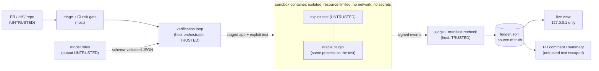

# Threat model: attack surfaces and declared limits

Exhibit A runs untrusted code (a pull request, a model-written exploit test) on purpose, so this
document lists what it defends against, what it does not, and what is still unbuilt. It does not
claim the system is "safe". The sandbox is **isolated and resource-limited**, not impenetrable,
and a green result means "nothing could be proven", never "safe".

Status vocabulary used in every table:

- **done**: implemented on `main`; the evidence column names a file or test that exists there.
- **pending**: designed or reported, not implemented. Do not rely on it.
- **limit**: a known hole we accept and declare. A strict xfail or a doc pins it where possible.

Inputs: `SPEC.md`, `docs/audit-integration.md` (sections 2, 7, 9), `docs/oracle-provenance.md`,
`docs/oracle-redteam.md`, `docs/oracle-a1.md`, `docs/github-action-security.md`, `docs/sandbox.md`.

## 1. System diagram and trust boundaries

| Boundary | Trusted side | Untrusted side | What crosses it |
|---|---|---|---|
| B1: repo to engine | engine code from the action's own checkout | PR files, diff, repo scripts | read-only parsing; nothing from the PR is installed or executed on the host |
| B2: model to engine | schema validator, loop | every model output (suspicions, exploit tests, fixes) | JSON validated against schemas; test and fix code only ever run in the sandbox |
| B3: host to container | orchestrator, key, manifest, judge, staged copy | exploit test and everything it imports | staged workspace copy in; HMAC-signed events out; key on stdin |
| B4: CI secrets | protected environment, one step | PR code, forks | model key only in the "Run Exhibit A" step; fork PRs get no run |
| B5: report to reader | ledger, escaped renderers | model text and diff content shown to humans | escaped HTML / Markdown |

Attacker model: the author of the PR and the author of the exploit test (model output, possibly
prompt-injected). The repository under analysis is the target, not a trusted party for host
execution; code it ships is trusted only as "the app" by the oracle (see R2).

## 2. Component table

### 2.1 Hostile PR / diff and prompt injection

| Component | Threat | Mitigation | Status | Evidence |
|---|---|---|---|---|
| Triage | PR touches workflows, build hooks, dependency pins | rule engine assigns low/medium/high and run / needs_approval / refuse; fails closed when the diff is missing | done (library only) | `src/exhibit_a/triage/assess.py`, `tests/test_triage.py` |
| Triage wiring | the Action does not yet pass the PR diff or call triage; `ci/gate.py` still has its own tables | delegate `gate.py` to `triage/` and pass the diff | pending | `src/exhibit_a/ci/gate.py` (audit F11) |
| Diff parsing | oversized or malformed diff exhausts the host | bounded diff parser | done | `src/exhibit_a/triage/diffparse.py`, `tests/test_triage.py` |
| Prompt injection in diff or code | text in the PR steers a model into proposing harmful tests or fixes | model output is never trusted: schema validation, sandbox-only execution, oracle proof required before any finding. Injection can waste budget or cause a missed finding; it cannot by itself create a `proven` verdict except through the oracle holes in 2.4 | limit | `src/exhibit_a/models/jsonschema.py`, `src/exhibit_a/oracle/oracle.py` |
| Diff to model | PR content treated as instructions | no separate injection filter exists; none is claimed | limit | n/a |

### 2.2 Model output

| Component | Threat | Mitigation | Status | Evidence |
|---|---|---|---|---|
| Schema validation | malformed or unexpected JSON drives the loop | strict JSON-schema validation; unsupported keywords raise instead of being ignored | done | `src/exhibit_a/models/jsonschema.py`, `tests/test_jsonschema.py`, `tests/test_models.py::test_invalid_output_is_rejected` |
| Fix application | model fix writes outside the clone (`../`, absolute paths, symlinks) | path and symlink checks before copy; size and file-count bounds | done | `tests/test_security_paths.py`, `tests/test_security_payloads.py` |
| Exploit-test source | test tampers with the oracle channel or the app tree | static AST tripwire (`guard.py`) before the test runs; a tripwire, not a boundary | done | `src/exhibit_a/oracle/guard.py`, `tests/test_oracle_provenance.py::test_the_guard_rejects_the_forgeries_before_they_run` |
| Cost | runaway spend | budget meter aborts the run and flushes the ledger | done | `tests/test_run_budget.py::test_budget_exceeded_mid_run_aborts_cleanly` |
| Model secrets | API key leaks into errors or logs | key from env only; HTTP errors do not echo it | done | `tests/test_meta.py::test_http_error_does_not_leak_key` |
| Replay data | recorded model calls tampered with | replay key depends on role, prompt and schema; replayed output is revalidated | done | `tests/test_models.py::test_replay_key_depends_on_role_prompt_and_schema` |

### 2.3 Sandbox

| Component | Threat | Mitigation | Status | Evidence |
|---|---|---|---|---|
| Network | exfiltration or callbacks | run step uses `--network none`; the build step (pip) has network and is separate | done | `src/exhibit_a/sandbox/runner.py`, `tests/test_sandbox.py::test_network_blocked` |
| Secrets | host env or tokens visible to the test | the container receives no host env; only the oracle key on stdin | done | `tests/test_sandbox_security.py::test_no_host_env_secrets` |
| Host files and Docker socket | escape through mounts | only a staged workspace copy is mounted; no docker.sock | done | `tests/test_sandbox_security.py::test_cannot_reach_docker_socket`, `::test_cannot_see_host_paths_outside_clone` |
| Privileges | root, capabilities, writes to the image | `--read-only`, `--cap-drop ALL`, `no-new-privileges`, non-root user, `/tmp` tmpfs | done | `src/exhibit_a/sandbox/runner.py`, `docs/sandbox.md` |
| Resources | fork bombs, memory or CPU exhaustion | `--pids-limit`, `--memory`, `--cpus`, wall-clock timeout | done | `tests/test_sandbox_limits.py` |
| Kernel | container escape through a kernel or runtime bug | none beyond the container runtime; shared host kernel | limit | `docs/sandbox.md` ("What these flags do not guarantee") |
| Cases that still run on the host | the Starlette replay baseline runs as a host child process; the in-process oracle path (`run_oracle`) is a host path | scrubbed child env only; moving into the sandbox is in progress | pending | `AGENTS.md` (current state), `src/exhibit_a/loop/runner.py` (audit F3, F8) |
| Docker absent | tests silently skipped and counted as green | sandbox tests fail (not skip) without Docker | done | `tests/conftest.py` (T060; audit F15) |
| Argument handling | `bash -lc` wrapper in the sandbox command | not changed | pending | `src/exhibit_a/sandbox/runner.py` (audit F17) |

### 2.4 Oracle

| Component | Threat | Mitigation | Status | Evidence |
|---|---|---|---|---|
| Forged events file (A-1) | test appends a fake proof | each event is HMAC-signed; key delivered on stdin, never in env or files; unsigned or wrongly signed lines are dropped and counted | done | `src/exhibit_a/oracle/plugin.py`, `tests/test_oracle.py::test_cheat_forge_signed_guess_is_dropped_and_counted`, `tests/test_sandbox_events.py::test_forged_event_line_written_in_the_container_is_dropped` |
| Symlink cheat (A-2) | test plants a symlink so a safe app reads the canary | reads through symlinks created during the run are flagged `via_symlink` and not proven | done | `tests/test_oracle.py::test_cheat_symlink_planted_by_the_test_is_not_proven` |
| Authenticated provenance | test writes a module into the app root, or forges a frame (`co_filename` + name) | manifest of the staged app, frame admission by code-object comparison, post-run rehash (`app_tree_changed`), host re-check against its own staged copy | done | `src/exhibit_a/oracle/provenance.py`, `tests/test_oracle_provenance.py::test_forged_frame_with_an_app_filename_is_not_admitted`, `::test_module_written_into_the_app_root_is_tamper_and_not_admitted` |
| `dir_fd` opens | real read dropped as relative path | resolve against the registered directory descriptor | done | `tests/test_oracle_provenance.py::test_dir_fd_read_of_the_canary_is_observed_and_proven` |
| Wrong-reason failures | test fails for an unrelated reason | verdict needs the canary read, through an entry point, called by the test | done | `src/exhibit_a/oracle/oracle.py`, `tests/test_oracle_eval.py` |
| Archive class | second effect class (write) | oracle eval set for archive extraction | done (host path only) | `tests/test_oracle_eval_archive.py`; sandbox wiring is audit F3 |
| R1: plugin introspection | test finds the hook via `gc`, reads the key, signs a forged event | none in-process; out-of-process stack reconstruction is post-freeze roadmap | limit | `tests/test_oracle_residual.py::test_r1_key_read_from_the_plugin_closure_forges_a_proof` (strict xfail) |
| R2: `sitecustomize` in app tree | start-up file captures the hook on the host path | sandbox does not put `/workspace` on `sys.path` at start; host path unprotected | limit | `tests/test_oracle_residual.py` (`test_r2_*`), `docs/oracle-provenance.md` 7.2 |
| R3: subprocess reads | vulnerable read by a child process is missed (recall only) | none; out-of-process observer is a deferred second signal | limit | `tests/test_oracle_residual.py` (`test_r3_*`), `docs/oracle-observer-spike.md` |
| R4: ctypes / native reads | libc `open` raises no audit event (recall only) | none | limit | `tests/test_oracle_residual.py` (`test_r4_*`) |
| R5: dependency monkeypatch by computed names | safe app's own entry point reads the canary after the test replaced a dependency | tripwire catches plain spellings only; differential can be defeated by a gated test | limit | `tests/test_oracle_residual.py` (`test_r5_*`), `docs/oracle-provenance.md` 7.5 |
| Proof gating (F1) | `proven` emitted before FIX/VERIFY, so an ineffective fix still yields `proven` | gate `proven` on a verified fix | pending | `src/exhibit_a/loop/pipeline.py` (`done(VerdictValue.PROVEN` before `_fix_verify_package`) |
| Test chooses app root (F2) | test passes the canary's directory to a safe app and the read counts as a proof | forbid canary-derived app arguments; judge `requested` path | pending | `src/exhibit_a/oracle/guard.py`, `src/exhibit_a/loop/prompts.py` |
| Defender blind on host path (F6) | bypass variants nested under `work/` so no bypass is ever proven | stage variants as siblings | pending | `src/exhibit_a/loop/pipeline.py` |

### 2.5 Secrets and CI

| Component | Threat | Mitigation | Status | Evidence |
|---|---|---|---|---|
| Trigger | `pull_request_target` hands secrets and a write token to PR code | trigger is `pull_request` | done | `.github/workflows/exhibit-a.yml` |
| Protected environment | key released without a human | `environment: exhibit-a` with required reviewers; reviewer must read `.github/` changes | done in template; reviewers are a manual GitHub setting | `.github/workflows/exhibit-a.yml`, `docs/github-action-security.md` |
| Token scope | broad `GITHUB_TOKEN` | `permissions: {}` at top; job gets `contents: read` and `pull-requests: write` only | done | `.github/workflows/exhibit-a.yml` |
| Checkout credentials | token left in `.git/config` | `persist-credentials: false` | done | `.github/workflows/exhibit-a.yml` |
| Key exposure | key readable outside the run step | key only in the "Run Exhibit A" step; leak scan of outputs before publishing | done | `action.yml`, `src/exhibit_a/ci/summary.py` |
| Spend | leaked or abused key | `budget-usd` meter plus a dedicated key with a provider-side cap | done in code; the provider cap is manual | `action.yml`, `docs/github-action-security.md` |
| Fork PRs | secret and untrusted code in one trust domain | out of scope: failing `fork-guard` job, no run | limit | `.github/workflows/exhibit-a.yml` (`fork-guard`), `docs/github-action-security.md` |
| Action self-reference | PR controls the action that judges it | template never uses `uses: ./`; Exhibit A action is a TODO placeholder | pending | `.github/workflows/exhibit-a.yml` (`TODO-pin-full-commit-sha`) |
| `case:` mode on the host | PR-controlled pip install and baseline run on the host with the key readable from `/proc/<ppid>/environ` | M-1 limits the install (see 2.6); replay baseline still on host | limit | `docs/github-action-security.md` (residual risks), audit F8 |
| Leak scan | encoded or split key not found | literal scan only; sandbox having no key is the real control | limit | `docs/github-action-security.md` |
| Skipped is green | removing the opt-in variable skips both checks and passes | documented; block on `not_run` is optional | limit | `docs/github-action.md` |
| Action output | model-reported fields and `result.json` unschemaed | `schema_version` and a schema for `result.json` | pending | `src/exhibit_a/ci/summary.py` (audit F13) |

### 2.6 Host-side installs (M-1 / T062)

| Component | Threat | Mitigation | Status | Evidence |
|---|---|---|---|---|
| Case requirements | `pip install` runs a package's `setup.py` on the host | `--only-binary=:all:` (no sdist build) into a `--target` dir | done | `src/exhibit_a/install.py`, `tests/test_install_isolation.py` |
| Env on install | API keys visible to pip and its children | install subprocess gets only `PATH`, `PYTHONPATH`, `PYTHONDONTWRITEBYTECODE` | done | `tests/test_install_isolation.py::test_install_subprocess_receives_stripped_env` |
| Malicious wheel | a wheel can run code at import time on the host | none; exploit tests run in the sandbox, but the host-side baseline can import the wheel | limit | `src/exhibit_a/install.py`, `docs/common.md` (M-1 line) |
| Hash-pinned installs | tampered index or mirror | no hash constraints file | pending | `src/exhibit_a/install.py` (audit F19) |

### 2.7 Data and reports

| Component | Threat | Mitigation | Status | Evidence |
|---|---|---|---|---|
| Live view | XSS from model text, diff content or ledger events | dynamic fields use `textContent` or the `esc()` escaper before `innerHTML` | done | `web/app.js` (`esc`, `highlightDiff`) |
| PR comment | HTML, links, `@mentions`, table pipes, marker hijack from model text | escaped by the summary renderer; marker stripped; only bot-authored comments are updated | done | `src/exhibit_a/ci/summary.py`, `tests/test_ci_summary.py::test_untrusted_text_is_escaped`, `::test_find_marker_comment_is_idempotent_and_author_bound` |
| Packaged paths | host paths and home directory leak into reports | package-relative paths; host, out, clone and home prefixes scrubbed | done | `tests/test_package_paths.py` |
| Ledger integrity | concurrent writers corrupt lines | validated events, single `os.write` on an `O_APPEND` descriptor | done | `src/exhibit_a/ledger/ledger.py`, `tests/test_ledger.py` |
| Ledger permissions | other local users read ledgers and run indexes | files are created `0o644`; no `0o600` and no redaction pass | pending | `src/exhibit_a/ledger/ledger.py` |
| Run index | corrupt or oversized lines break readers | strict schema, tolerant reader with a problems list | done | `src/exhibit_a/ledger/index.py`, `tests/test_run_index.py` |
| Artifact contents | clone, diff or logs published from CI | only `ledger.jsonl`, `result.json`, `summary.md` uploaded | done | `action.yml` |
| Verdict schema versions | consumers cannot tell formats apart | `schema_version` on `evidence.json` / `verdict.json` | pending | `src/exhibit_a/schemas/verdict.py` (audit F13) |

### 2.8 Supply chain

| Component | Threat | Mitigation | Status | Evidence |
|---|---|---|---|---|
| Actions in the Exhibit A workflow and action | mutable tags | third-party actions pinned by full commit SHA | done | `action.yml`, `.github/workflows/exhibit-a.yml` |
| Actions in the project's own CI | mutable tags (`@v4`, `@v5`) | pin by SHA | pending | `.github/workflows/ci.yml` (audit F14) |
| Sandbox base image | mutable tag | `python:3.11.9-slim` is pinned by version tag, **not by digest**; tools pinned (`pytest==7.3.2`) | pending (digest) | `src/exhibit_a/sandbox/image.py`, `src/exhibit_a/sandbox/runner.py` |
| Image reuse | stale or wrong environment | image tag is a hash of base plus normalized requirements | done | `src/exhibit_a/sandbox/image.py`, `tests/test_sandbox_image.py` |
| Python dependencies | floating ranges | `pydantic>=2.5`, `pytest>=7` are ranges; no lock file with hashes | pending | `pyproject.toml` |
| Case dependencies | unpinned case requirements | benchmark cases pin versions | done | `bench/corpus/starlette-cve-2023-29159` |
| Engine action install | action's own pip install unhashed | hash constraints file | pending | `action.yml` (audit F19) |

### 2.9 Local dashboard and advisory module

| Component | Threat | Mitigation | Status | Evidence |
|---|---|---|---|---|
| Live server | remote access to ledgers and diffs | binds `127.0.0.1` by default; bind failure reported; `--host` can override (user's choice) | done | `src/exhibit_a/live/server.py`, `tests/test_live.py::test_cli_defaults_and_bind_failure` |
| Live server routes | path traversal through static file serving | unknown routes 404; no authentication (loopback only) | limit | `tests/test_live.py::test_unknown_route_is_404` |
| Advisory data | network data (OSV records, versions) reaches `exec`/`eval` | records are parsed into typed models; ranges are evaluated by local code; no `eval`/`exec` in the module; a match is a hint, never a verdict | done | `src/exhibit_a/advisory/osv.py`, `src/exhibit_a/schemas/advisory.py`, `tests/test_advisory_osv.py` |
| Advisory parsers | hostile version strings or records (huge numbers, deep recursion) | version parsing is bounded only partly; no length caps or `RecursionError` handling | pending | `src/exhibit_a/advisory/version.py` (audit F12) |
| Advisory HTTP | live service never exercised; redirects not restricted | stdlib `urllib` backend; replay backend used in tests | limit | `src/exhibit_a/advisory/osv.py`, `docs/advisory.md` |

## 3. Audit coverage (docs/audit-integration.md sections 2, 7, 9)

Every finding F1-F20 and risk R1-R5 appears below as fixed (task id), pending, or a declared limit.
Nothing is listed as fixed unless a change on `main` is named. At the time of writing none of the
critical findings (F1, F2) is fixed.

| ID | Sev | Subject | Status | Task / evidence |
|---|---|---|---|---|
| F1 | critical | `proven` before FIX/VERIFY | pending | `src/exhibit_a/loop/pipeline.py`; audit task T-A11-1 |
| F2 | critical | test chooses app root; safe app proven | pending | `src/exhibit_a/oracle/guard.py`; audit task T-A11-2 |
| F3 | high | second class not wired into loop, sandbox, CLI | pending. T056 makes the bench adapter fail closed for unsupported effects; the CLI is unchanged | `bench/loop_pipeline.py`, `tests/test_bench_loop.py` |
| F4 | high | effect classifier confuses read and write opens | pending | `src/exhibit_a/oracle/plugin.py` |
| F5 | medium | write recall: rename, link, mkdir not observed | limit | audit section 7 |
| F6 | high | defender blind on host path | pending | `src/exhibit_a/loop/pipeline.py` |
| F7 | medium | `reason_code`, `effect` not persisted in verdict | limit until fixed | `src/exhibit_a/schemas/verdict.py` |
| F8 | medium | `case:` mode: host install and baseline with key readable | partly mitigated by M-1 (T062: binary-only install, stripped env); remainder is a declared limit | `src/exhibit_a/install.py`, `tests/test_install_isolation.py` |
| F9 | medium | oracle-eval archive test not parallel-safe, rewrites a doc | limit: do not run the suite in parallel | `tests/test_oracle_eval_archive.py` |
| F10 | medium | README/SPEC/docs over-claims | pending. SPEC was reconciled in T053; the README and docs claims listed in the audit were not rechecked here | `SPEC.md` |
| F11 | medium | Action lacks `--provider/--model` and a diff surface | partly fixed: flags added by A-6 (T058); PR diff surface still missing, so PR runs report `not_run` | `src/exhibit_a/cli/parser.py`, `tests/test_cli.py` |
| F12 | low | advisory version parser unbounded | limit | `src/exhibit_a/advisory/version.py` |
| F13 | low | no schema for `result.json`, no `schema_version` on evidence | limit | `src/exhibit_a/ci/summary.py` |
| F14 | low | project CI actions not SHA-pinned; no Docker job | limit | `.github/workflows/ci.yml` |
| F15 | low | sandbox tests hard-fail or skip without Docker | fixed: T060 | `tests/conftest.py` |
| F16 | low | Python 3.14 code-key failure (PEP 649) | limit; task T068 owns the fix | `tests/test_oracle_provenance.py::test_code_keys_cover_every_code_object_of_the_fixture_apps` |
| F17 | low | `bash -lc` in the sandbox command | limit | `src/exhibit_a/sandbox/runner.py` |
| F18 | low | `tests/test_probe.py` assertion style | limit | `tests/test_probe.py` |
| F19 | low | action install not hash-pinned; engine output not scanned | limit | `action.yml` |
| F20 | low | host path: `package_src` writable | limit | `src/exhibit_a/oracle/oracle.py` |
| R1 | residual | plugin introspection | limit | `tests/test_oracle_residual.py` (strict xfail) |
| R2 | residual | `sitecustomize` in app tree (host path) | limit | `tests/test_oracle_residual.py` (strict xfail) |
| R3 | residual | subprocess reads (recall) | limit | `tests/test_oracle_residual.py` (strict xfail) |
| R4 | residual | ctypes reads (recall) | limit | `tests/test_oracle_residual.py` (strict xfail) |
| R5 | residual | dependency monkeypatch by computed names | limit | `tests/test_oracle_residual.py` (strict xfail) |

Audit section 9 top risks map to: risk 1 (F1 + F2) and 4 (F6) are open and are the first things
to close; risk 2 (F4) is open; risk 3 (F3) means the archive class must not be described as
"proven in the sandbox"; risk 5 (F8) is partly mitigated by T062.

## 4. What this document does not claim

- It does not say any component is "100% safe". Isolated and resource-limited is the strongest
  wording used for the sandbox.
- A `proven` verdict today is trustworthy only up to the open oracle items above (F1, F2, F4, F6,
  R1, R5). Until F1 and F2 are fixed, treat a `proven` result as a lead for human review.
- A green result means nothing could be proven, not that the code is safe.
- Statuses were checked against the `main` source tree on 2026-10-29; re-check them when the
  pending items land.
